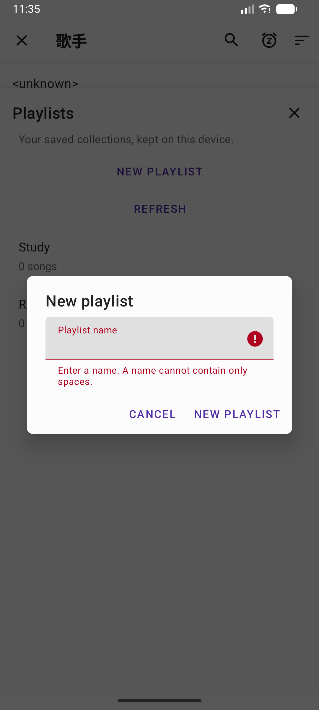
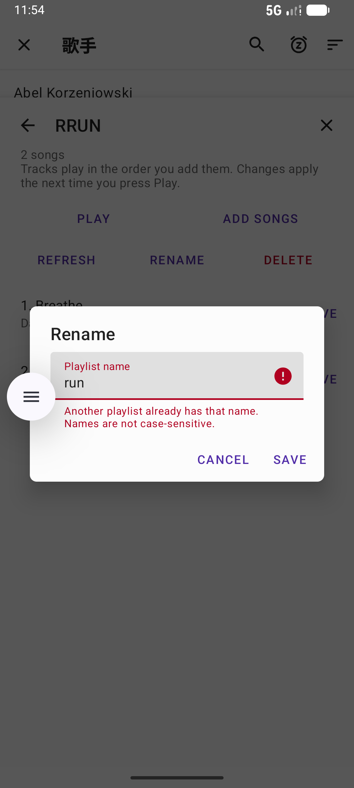
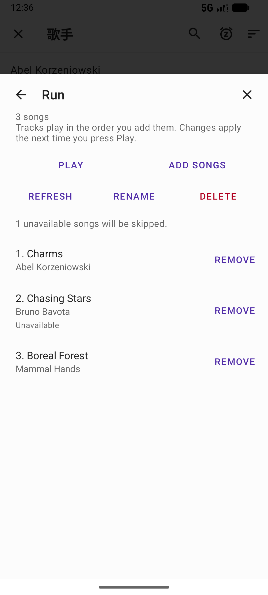
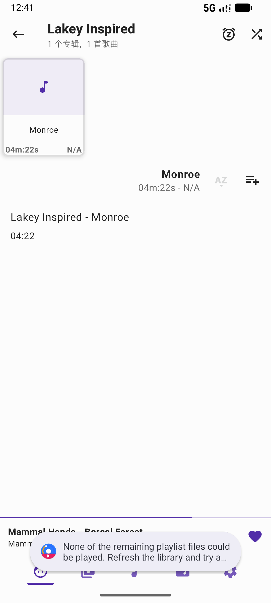

# Custom Playlists: Manual Acceptance Results

- **Test date:** 2026-10-26
- **Tester:** 曾沛涵
- **Device:** Android Emulator, Medium Phone API 37.0; Android 17; Google Play x86_64 system image; 1080 × 2400, 420 dpi
- **Branch:** `feat/custom-playlists`
- **Tested commit:** `785e0863e1efa8f44574cec1444b649a4016c911` (see note below)
- **Test plan:** [Custom playlists manual acceptance plan](custom-playlists.md)
- **Test tracks:** Three distinct local audio files, referred to as A, B and C. Record the exact filenames separately if available.

The tester confirmed that the checks described in the test plan were performed. The entries below record the reported results; screenshots show selected observations, not every step. Each case uses the initial state specified in the test plan. For persistence checks, the app was force-stopped and reopened without clearing data or reinstalling.

## TC01 — Create playlists and validate names

**Result: Pass for the listed test-plan checks.** Created and opened two empty playlists; leading and trailing spaces were removed. Empty and whitespace-only names and a case-insensitive duplicate were rejected with an explanation.

## TC02 — Rename and validate names

**Result: Pass.** Renaming trimmed surrounding spaces and preserved playlist contents. Empty, whitespace-only and conflicting names were rejected. Renaming to the current name or a case variant was accepted; the other playlist and track order remained unchanged.

## TC03 — Add tracks and prevent duplicates

**Result: Pass.** The same track could belong to two playlists. Adding an existing track again did not duplicate it or change its position, and feedback was provided. Playlists retained their expected members and order.

## TC04 — Remove a playlist member

**Result: Pass.** Removing B from Study left it in Running and in the local music library. Its audio file remained available and playable; the remaining members and order were unchanged.

## TC05 — Delete a playlist

**Result: Pass.** Study disappeared after deletion, while Running remained unchanged. The A, B and C audio files and library entries remained available, and A could be played.

## TC06 — Play in saved order

**Result: Pass.** A playlist created in C, A, B order started at C; two manual next-track actions produced C → A → B. After restarting playback, the natural transition was C → A. The saved playlist order remained C, A, B.

## TC07 — Persist created playlists and members

**Result: Pass.** After force-stopping and reopening the app, Study remained [A, B], Running remained [B, C], and Order remained [C, A, B], preserving names, members and order.

## TC08 — Persist a renamed playlist

**Result: Pass.** After renaming Study to Focus and restarting the app, Focus retained [A, B], Running retained [B, C], and Study no longer appeared.

## TC09 — Persist a removed member

**Result: Pass.** After removing B from Study and restarting, Study remained [A], Running remained [B, C], and B remained in the local library and playable.

## TC10 — Persist playlist deletion

**Result: Pass.** After deleting Study and restarting, it did not return. Running remained [B, C], and the test audio files and library entries remained available.

## TC11 — Empty playlist behavior

**Result: Pass.** An empty playlist displayed an empty-state message and could not start playback. After adding and removing its last track, the empty state returned, the app did not crash, and the audio file remained available.

## TC12 — Mark and skip an unavailable track

**Result: Pass.** After removing the test copy of B and refreshing the library, B remained visible as unavailable in the affected playlists. Running started with C; Mixed started with A and skipped B to C both on manual next and after A ended naturally. Other members remained available and the app did not crash or repeatedly retry B. The test file was restored after the check.

## TC13 — All playlist members unavailable

**Result: Pass.** When the only playlist member was unavailable, the entry remained visible with an unavailable indication and the app explained that no playable tracks were available. Playback did not start and the app did not crash. The test file was restored after the check.

## Remaining verification

These results cover TC01–TC13 as reported by the tester. They do not establish results for RG01–RG07, code review, or acceptance-criteria sign-off. Record those separately after execution.

The commit identifies the repository revision used to build the app. The local branch was at `785e0863` when the debug build was installed; if the app was rebuilt or replaced during testing, confirm the installed build's source revision before relying on this value.
