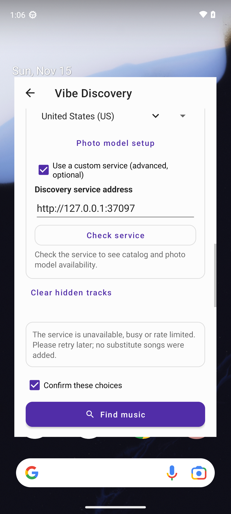
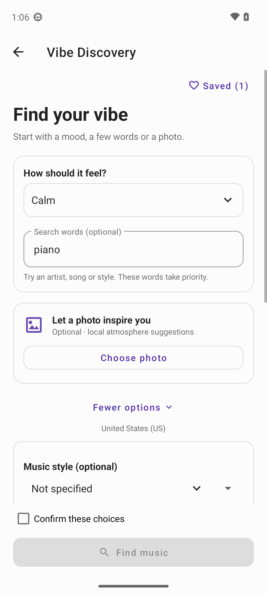

# PR #69 — visible feedback and recovery without transient results

## Scope and implementation

Refs [Story #68](https://github.com/Axfff/Vibe-Player/issues/68), [overall Story #36](https://github.com/Axfff/Vibe-Player/issues/36) and [PR #69 findings](https://github.com/Axfff/Vibe-Player/pull/69#issuecomment-6874699957). Owner: Shiyuan LIN / CroissantXinny, with Codex-assisted implementation, technical review and automated execution. The pre-work plan/estimate was recorded on #68 at 2026-11-15 20:50:47 SGT. Sprint 3 follow-up; Sprint 4 scope/budgets and human AC remain unchanged.

- Integrated #66 `3041a8f3985a01d81c5e6d77fcac85b1e96722a1` through `d4588592`, retaining its search ranking, per-song evidence/Collection compatibility and source-status fixes, plus #62 pending fixtures/provenance. The two branches had different tests named `DiscoveryPresentationTest`: the original four layout tests are retained as `DiscoveryLayoutTest`, and the two #66 evidence/status tests keep their name. Neither suite was dropped. Target remains `fix/english-ui-20261112`.
- Repair `677b2e29103d148fe665652ed9f98bd821053f17` moves the message and Cancel into a common fixed feedback area beside the search actions, outside the scrolling body. Errors, request progress/cancellation, Collection errors and shortages remain visible regardless of More options scroll position. Polite accessibility announcements and existing retry/confirmation rules remain.
- Restored UI uses the form whenever the current ViewModel has no result object. A saved `editing=false` cannot create a phantom results page after results are lost. Durable Collection remains available; normal recreation keeps its retained results/editing state, and an actual empty response keeps its no-results explanation.
- No new results persistence, storage migration, data deletion, permissions or network/model policy is introduced. Collection JSON/writes remain unchanged from #66. The real phone and other worktrees were untouched.

## Local verification

Production code is `677b2e29`; `f00f2dc9767d64f18c674e8f6e2b185580887adb` only synchronizes optional screenshots with rendered frames.

| Check | Actual result |
| --- | --- |
| JVM / both APK builds | 136 tests passed; main and Android-test APKs built with pinned JDK17/Gradle dependencies |
| Coverage contract | 17 passed; unchanged baseline and 80% per-module gates |
| API33 `emulator-5560` focused suite | 36 passed in 84.079 seconds |
| Final screenshot synchronization / new regression suite | All 6 DiscoveryRecoveryTest cases passed again in 63.470 seconds |
| Production scope | 94 files, retaining original scope and both #66 additions, including Release 1 |

The 36-case selection includes DeviceCatalog, DiscoveryPresentation, DiscoveryLayout, DiscoveryRecovery, DiscoveryFlow, DiscoveryBoundary, PendingDiscoveryPhotos and EnglishUi tests. All fixtures run on the disposable emulator after `ro.kernel.qemu=1` verification. Catalog rows are synthetic; HTTP transport and the **45-second request deadline** execute for real. No live-catalog/model quality or physical-phone acceptance is claimed.

New cases verify full viewport intersection/size of Cancel, feedback and Find music after scrolling to the bottom of a **360 × 640 dp Activity window**, delayed request/cancel/retry, HTTP503 and real deadline timeout, byte-identical legacy Collection/exclusions/intent, real framework Bundle restoration with a cleared ViewModelStore and asserted different ViewModel instance, retained-model rotation, Collection restore/back, and legitimate zero-song responses. Separate inflated-layout checks measure unclipped text/actions at 130% font scale in light/dark configurations at 360 × 560 dp. The fresh-ViewModel test reproduces the loss-of-transient-state boundary; it is **not a physical process-kill experiment**.

## Preserved initial failure and correction

The first local 36-case run had **3 failures** in the new tests: they confirmed inputs before resizing/scroll callbacks settled, so spinner callbacks correctly invalidated confirmation and no discover request was sent (`connected` timeout / request latch not entered). Test setup now waits for bottom scroll/layout completion, confirms afterward and asserts that Find music is enabled before clicking. No production confirmation rule or assertion was weakened. The failed log remains under local verification, SHA-256 `0963afd963513ea2f17cdf278f0a2a20f5f535aab08f61494f72ea2ad07e69af`.

Visual inspection then found two opt-in screenshots captured a prior rendering frame even though UI assertions had passed. Test-only commit `f00f2dc9` waits for accessibility idle and two frames before capture. All six new cases passed again with the synchronized screenshots. This does not alter production behavior or hide the original failure.

## Artifacts and inspected screenshots

Local originals: `verification/pr69-feedback-20261115/`. Main APK SHA-256 `ad02e9db822d6ebdf1caf97105642f9a5f6da373faf20962b6685bb71b4e654b`. The 36-pass test APK was `247bb877e3d8f2683772833c8f033a85c3204ab269935e0633285af17e27a3c3`; final screenshot-test APK was `b81ee20fa19a4b52fadc48036d9f95ee18e5fe25e14ebf335d518755f1a3416a`. Their production APK is identical. Logs: 36-pass `ba32127b4bb7c95c752ac63065651606924908dc053cb16d259fb2a1b51a6759`; final six-pass `038c1b0a28be1c1de8134a18dfac5747b18d5aa21f317503d338b5e927848836`.

The error capture uses the explicitly constrained Activity window; the outer emulator launcher is visible. It is not the app's default full-screen sizing. The restored-form capture is full screen. Both are original, unedited emulator captures with synthetic data.

Image SHA-256: error `e4a9489cde82cc3649191e68f6fc9d012a7cbab772ed7a3001dd6b8b56f445a2`; restored form `4555eeca4e2aef15537498a3f1b66dabd15d68ffa4cf883f0caaeb652815782b`. Busy, cancelled and timeout captures are also retained in the local evidence manifest.

## CI and review boundary

This record is committed before full CI dispatch. [PR #69's dated final verification](https://github.com/Axfff/Vibe-Player/pull/69) owns the exact tested final head/run, original report ZIP digest, independent 94-source/provenance/XML/HTML/JUnit audit and covered/total values. Full CI is pending at this record's creation, not claimed in advance. A manual dispatch on the stacked target normally skips its PR publisher while running every build/test/coverage gate.

Technical self-review found no remaining in-scope blocker after local checks. Axfff's genuine review is requested after final exact-head CI/report audit. No approval, merge, AC checkmark, Issue closure, release-tag or product-budget decision is supplied. Main inspected: `99bc4264f55c2de2ec4c3fdfdeba6fb974f0a4b9`; later main/#61/upstream integration still needs its own verification. Previous failures, live evidence, phone versions and human acceptance boundaries remain historical. Additional catalogs, lawful previews and audio mutual exclusion remain Sprint 4 work.
