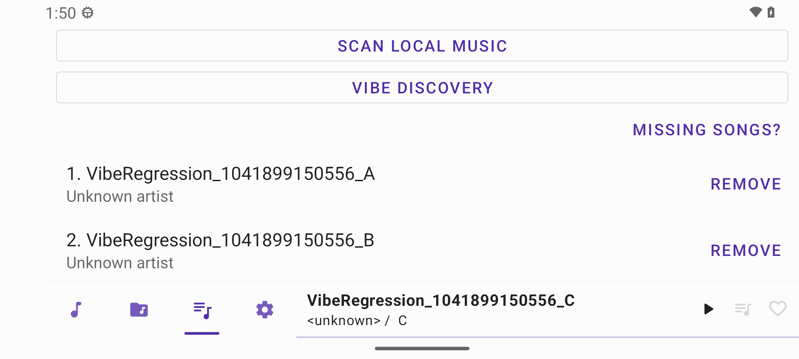
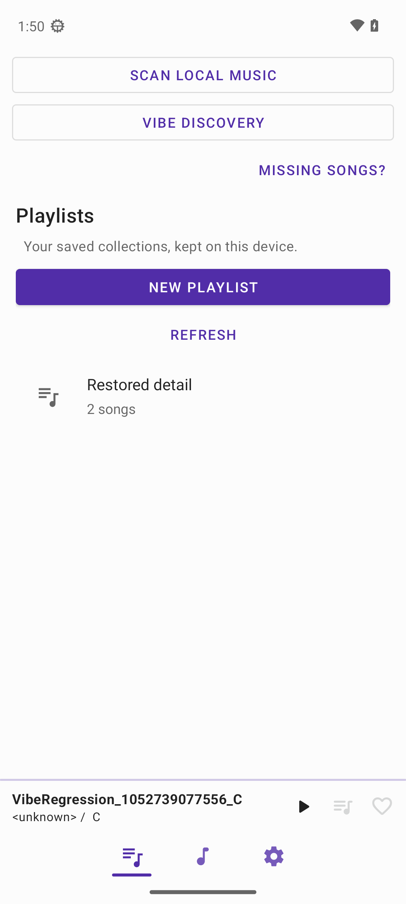

# PR #70 — playlist navigation repair verification

Date: 2026-11-15 (Asia/Singapore). Refs [Story #67](https://github.com/Axfff/Vibe-Player/issues/67), [four review findings](https://github.com/Axfff/Vibe-Player/pull/70#pullrequestreview-5909978000).
Original implementation: peihanZENG. This repair: Shiyuan LIN / CroissantXinny, Codex-assisted implementation, execution and technical review; no teammate approval or human acceptance is supplied.

## Scope and decisions

The pre-implementation owner/estimate/tasks are appended to #67 with the actual date. Merge `aa9ee31b` preserves the original #70 commits and integrates latest #61 `d6c6ba5870b0318484b94be6ecf6cea4a0e5667a`, including main `99bc4264f55c2de2ec4c3fdfdeba6fb974f0a4b9`. Only the generated coverage inventory conflicted; it was regenerated from the combined tree. Cover and photo repository source files are identical to #61. The intended PR target is #61's `fix/cover-review-main-20261112`, replacing the obsolete cover-foundation target so the review isolates navigation. Final main/other-PR integration requires its own checks.

Production/test repair commit: **`9ba3cd7b7064e0d24c92d249d0118ba591c8ccf4`**. Later evidence/inventory-only commits do not change the tested production code.

- Preserve the existing configurable-tab behavior. Migration commits both tab lists and a one-time marker together; an already-offered Playlists tab stays hidden when that was the user's choice. Other order/visibility and saved playlists remain unchanged.
- MainActivity routes Back to the actual resumed playlist fragment restored by ViewPager2. Returning to the list expands its controls. Both first-position and ordinary-position tabs are tested.
- Page and fallback dialog share the photo-source opener and independent target cleanup. Shared sources, another target's scope/cover, and stale-request revision protection survive deletion.
- Both hosts share control XML. The page places controls in a scrolling AppBar and keeps a recycled track list beneath it, so a short landscape window can scroll controls away and reach tracks/Remove. The dialog retains its existing sheet layout and behavior.

No playlist schema, memberships, playback/queue logic, model/configuration, authorization or permissions were changed. The only new preference is the tab migration marker. The connected phone was not installed, reset, uninstalled or otherwise modified. Existing files/worktrees, the user's untracked feature summary and `release1` remain intact.

## Actual local verification

- **131 JVM tests**, both debug APK builds and **12 coverage-contract tests** passed.
- **40 API33 Android tests** passed in the final focused run, including all **9 new navigation regressions**, existing PlaylistLibrary/Presentation/Coverage behavior, and CoverStorage/CoverUi regressions. Logs and failed earlier attempts are retained below.
- Actual tab-view clicks open the page; detail survives Activity recreation/device rotation; a real system Back key returns to the list in the same tab, including Playlists-first configuration.
- Migration tests drive the actual Settings adapter row/save output. A separate successful migration test prepared the fixture; then adb **force-stopped and relaunched the app**. Visible tabs stayed `SONGS_TAB, SETTINGS_TAB`; available order, marker, saved playlist JSON and an unrelated preference were byte-for-byte/value-identical. Saved playlist JSON SHA-256: `f8560123af88b0265b58cc61a0b3e3d0d73b723f73dd238be839b97514fd0e01`. This is actual emulator process restart, not a new-object-only claim.
- Both the real empty-library toolbar fallback and the tab expose the selected target's Photo Sources dialog. Deletion through its confirmation removes only the selected target scope/cover, preserves another playlist and shared source, and rejects the deleted target's old request revision. Source URIs/cover bitmaps are synthetic authorization/storage fixtures, not photo recognition evidence.
- Landscape tests freeze device rotation through UiAutomation, assert the live window remains wider than tall, swipe the controls, require the whole saved row and Remove button inside the visible viewport, then verify only the selected membership is removed. The 130% font case uses the same actual window checks. Optional screenshots wait for accessibility idle and two rendered frames, and reject portrait captures for landscape cases. Font/rotation overrides are restored after testing.

Device: disposable `emulator-5560`, API 33, Physical size: 1080x2400, Physical density: 420; landscape captures are 2400×1080. The reset fixture explicitly refuses real phones. No claim of Redmi acceptance is made.

APK SHA-256: production `b9677219463ce418f773cb86870048093656c6674c22aa72ff8c5fecd5651117`; final test package `20acb6987bbbfb18ba9a2d153d4d07da05fc7cf88fd4483399749a842950a9d8`.

Commands: pinned JDK17/SDK33/Gradle8 offline build `:app:testDebugUnitTest :app:assembleDebug :app:assembleDebugAndroidTest`; `python scripts/test_coverage_contract.py`; adb instrumentation selects `PlaylistNavigationRepairTest`, `PlaylistLibraryRegressionTest`, `PlaylistPresentationRegressionTest`, `PlaylistCoverageBehaviorTest`, `CoverStorageRegressionTest`, `CoverUiRegressionTest`. Optional `-e pr70Screenshots true` captures synthetic UI evidence. The cold-start setup separately selects `PlaylistNavigationRepairTest#upgradeThenSettingsHideSurvivesFreshPreferencesWithoutRewritingPlaylists`, followed by `am force-stop` and `am start -W` with stored preference comparison.

## Retained failures and strengthened checks

The first new-test compilation failed on test-only helper/resource references; corrected references compiled. Two early nine-test runs each had one setup failure in the first-tab case: changing order with an old pager's saved state did not emulate Settings' fresh-Activity application; then seeding the repository after that first page loaded needed the real Refresh action. The fixture now seeds initial order before launch and clicks Refresh after repository seeding. Production navigation/consent behavior was not weakened to satisfy the tests.

An intermediate 40-test run passed, but visual inspection found its supposed landscape captures were portrait: an Activity orientation request was superseded during recreation by the app's normal FULL_USER policy. That run is **not landscape evidence**. Tests now freeze the device rotation, assert actual window geometry throughout and validate screenshot orientation; the final focused run supersedes that boundary. Earlier logs and image hashes remain in the local `before-landscape-audit.json` and are not relabeled as successful landscape proof.

| Original log | SHA-256 |
| --- | --- |
| `repair-test-build.log` | `8530f62972796e44874254c35dabee1646ab859fb2ff4b0227a15bed64b2d86a` |
| `repair-tests-first.log` | `5a2b37812dbba1d1fc05a647eb6c330d3a63c93e337b45cdd85be991b26ce786` |
| `repair-tests-final.log` | `86ddc4a603f2b576df884201a1850de0275d1387e5727bd7df7837d2f66e7f09` |
| `focused-tests.log` | `c9f2f85fb05a4eba94a9628ce9551d74339089690956597ade705604c3b649ac` |
| `focused-tests-verified.log` | `b1fa445cf0486293a3751f35abe55d942a8e44f1f294759dcbd4afb6d85a68a8` |
| `cold-start-setup-test.log` | `00547a234c6f094ab7b96f351c40493d940a6ea54a4465094fffceaf9364065d` |

## Inspected original captures

Image SHA-256: landscape `a624b92466ff5aa9ed24bf522d3ff53af6fa1afdad51aad0ade2fa0a31a66ebe`; restored list `bc1dd08f0ccf9fbc7930ccc30f4ccf17578b9232f7e98d1eba0f7ca8166a1112`. These are original unedited emulator captures with synthetic data.

## CI and review boundary

This record is committed before the final full CI run. [PR #70's dated final verification](https://github.com/Axfff/Vibe-Player/pull/70) owns its exact tested final head/run, original report ZIP digest, independent **91-source** hash/full-attribution/XML/HTML/JUnit audit and covered/total values. The cumulative baseline and 80% per-module gates, including Release1, are unchanged. The branch's push workflow runs the full gates while its automatic PR publisher is normally skipped for a push event.

Technical self-review found no remaining in-scope blocker after the final local checks and screenshot inspection. Axfff's review is requested only after current-head full CI/report audit. Existing title, original body, historical reviews/tests, contributions, Issue state and unchecked AC are preserved. No merge, approval, Issue closure or new Sprint/model-budget decision is supplied.
