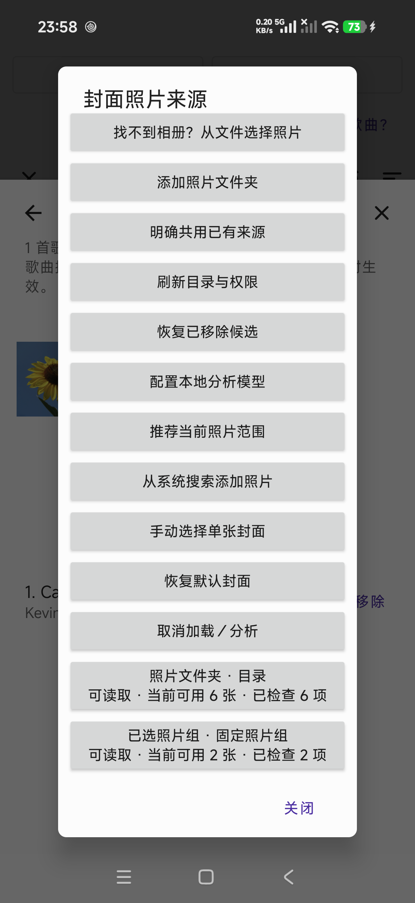

# Picture atmosphere ranking and review follow-up — November 10

Broad picture-atmosphere matching recovers the four-case regression while keeping
specific object descriptions conservative. The app also adds a usable manual
Xiaomi album guide and addresses the five photo-feature findings in Issue #51.
Human AC and subjective quality sign-off remain pending.

## Actual Android comparison

Production commit `b30b7e265e32e2f15b6e479d349d102515007cbc`, debug APK SHA-256
`2557a27c60fb524b22e02cb7fe4cdf846f2113b73437d24398908c8cdfbc3aa7`.
The [raw results](evidence/photo-atmosphere-2026-11-10/real-ranking.json) record the
complete production fingerprint, audio scores, image hashes, conservative scene
labels, atmosphere supports, actual rankings, failures and timings. No private
content URI, user media or model weights are published.

| Frozen provisional case | MobileNet baseline P@5 | scenes-v2 P@5 | atmosphere-v3 P@5 | Relevant / returned | Difficult distractors |
| --- | ---: | ---: | ---: | ---: | ---: |
| 01, bright | 1.00 | .60 | 1.00 | 5 / 5 | 0 |
| 02, calm | 1.00 | .60 | 1.00 | 5 / 5 | 0 |
| 03, reflective | .40 | .20 | .80 | 4 / 5 | 1 |
| 04, intense | .80 | .20 | 1.00 | 5 / 5 | 0 |
| Mean | **.80** | **.40** | **.95** | **19 / 20** | **1 total** |

All 80 image extractions succeeded. Twelve had insufficient/unsuitable atmosphere
support, compared with 52 lacking an accepted scene cue in v2. Cold photo analysis
took 2.462–3.142 seconds per 20-image case; cached reads took .142–.311 seconds on
the API 33 emulator. These are not phone latency measurements. The larger 40M
desktop experiment also scored .95; retaining 8M avoids its larger storage cost.
The [export receipt](evidence/photo-atmosphere-2026-11-10/model-export.json) records
the 33,313,206-byte model. Two independent exports matched its pinned SHA-256.

The final run used fixture [PR #49](https://github.com/Axfff/Vibe-Player/pull/49)
commit `7592fbac`, **music-photo-v2**, with candidate order independent of relevance
rows. All media, case membership, representative tracks and CSV label bytes are
unchanged from v1. The new order produced identical Top-5 IDs to the first v3 run;
each actual case also asserts equal ranking when its extracted candidates are
reversed. The corrected [official evaluator output](evidence/photo-atmosphere-2026-11-10/evaluation.json)
accepts short result lists while retaining five as the P@5 denominator.

This is a development comparison on already-seen, AI-proposed labels, **not a
fresh held-out test or an accuracy guarantee**. The image `img_0015` remains a
difficult distractor in case 03: its bright, still lake fits the audio model's
strong relaxing signal but not the provisional reflective target. No labels,
per-image exceptions or case-specific ranking rules were changed to remove it.
Human listening/visual review and fresh examples remain necessary before quality
acceptance. See [model/ranking policy](../development/photo-scene-model.md).

## Xiaomi manual search-to-album route

The phone is now Android 17 / API 37, T/U extension 22. Seven public API probes
still found no functioning automatic query handoff in this provider; the app
cannot make the Xiaomi picker start directly on matching search results.

The manual route is **小米相册搜索 → 多选 → 添加到 → 新建相册 → 复制 → 回到
Vibe-Player → 选择整理好的照片 → 确认目标 → 推荐当前照片范围**. The new
**小米相册搜索后添加** guide opens ordinary selection or the existing folder
authorization route. It explains fixed selected groups, refreshable folders,
the file-selection fallback, and Xiaomi's cloud-synchronized deletion warning.

The real search-result Add to / New album menu was verified separately. The full
album creation/grant test used two known licensed flower fixtures from the QA
album: both copied files matched their originals, the new album appeared in the
system picker, and the app read both explicitly confirmed photos. This does not
claim that the fixtures were found by the attempted search query; the keyboard
altered that query, and no relevance accuracy was inferred from its results.

The temporary binding and album copies were removed. The original six-image
directory, original playlists, all ten fixture files and saved cover were retained.
The [sanitized receipt](evidence/photo-atmosphere-2026-11-10/album-bridge.json)
records the separate steps and limits. Private gallery screenshots remain local.
The screenshot's background sunflower is licensed fixture `img_0001`; attribution
and changes are in [the bundled fixture credits](https://github.com/Axfff/Vibe-Player/blob/7592fbac/test-data/music-photo-v2/ATTRIBUTION.md).

## Review fixes and tests

- ONNX construction, inference and synchronous close share the same IO ownership
  scope. Cancellation during blocking construction or suspended inference closes
  exactly once; no cancellable dispatcher switch is needed for cleanup.
- Pagination reserves one contiguous page and disables repeated loads. Cancellation
  does not consume the offset, and a new ranking cancels its predecessor.
- Playlist deletion reports failed photo-scope storage cleanup and still attempts
  cover cleanup independently. Missing covers are a normal outcome.
- Changed album identities expose an explicit, confirmed empty rebind. Cancelling
  retains the old source; shared sources survive; old requests cannot revive even
  if the metadata later returns to its previous value.
- Candidate verification returns the exact hashed bytes to the crop decoder. A
  provider mutation cannot substitute a second, unverified read for preview.

Targeted JVM tests cover ownership, scope read/write failures, rebinding, paging,
invalid scores, weak/uniform atmosphere and document/screenshot exclusion. Android
tests cover guide cancellation, real folder grants, provider mutation, crop save
and revoked access, plus rebind confirmation/cancellation. The new fixture-order
run and three source/recommendation UI tests passed together (four tests).

The previously repeated CI playback failure occurred immediately after a seek.
The test now requires two seconds of stable decoded playback before changing
display settings. Its existing player identity, playlist/order, playing-state
and position bounds (`−150 ms`, `elapsed + 1500 ms`) are unchanged. Local targeted
playback tests pass; this strengthens the precondition and does not prove that
every CI failure had the same cause. Current-head CI is reported on the PR.

Full clean local validation at `abf503ea` passed: 111 JVM tests, 68 Android tests
(four optional asset tests skipped in this general run; real model inference was
verified separately above), 159 backend tests, 22 web tests and 12 coverage-contract
tests. Measured coverage is Android 2672/3262 (81.91%), backend 882/920 (95.87%,
local Python 3.14) and web 812/825 (98.42%). Both [push CI](https://github.com/Axfff/Vibe-Player/actions/runs/42662115932)
and [PR CI](https://github.com/Axfff/Vibe-Player/actions/runs/42662133181) passed
at that head. Latest-head results remain linked on the PR.

Fixture PR #49's `7592fbac` CI independently exposed a final scan-button assertion
that preceded the observer's UI update. A bounded wait now requires the actual
button to re-enable; it does not bypass the assertion. Its targeted Android test
passed locally, and the same test-only fix is included in #37, #49 and #50. The
[failed run](https://github.com/Axfff/Vibe-Player/actions/runs/42660921992) remains
available; no failure was erased or relabeled as a pass.

The full-build debug APK, SHA-256
`9ecc3ac2107c1d9c87b281643aa43fa6de0948d8e137d14073107ad8fc8fbdea`,
was installed in place on the connected phone. The exact pinned v3 model is
hash-verified in app-private storage via debug provisioning; earlier models remain.
This does **not** establish in-app import or phone UI behavior. Those checks await
the user's unlock. The two pre-existing playlists, all ten seed files and saved
cover hash remain unchanged. No personal photos are needed for the remaining step.

## Cold-start cover rendering follow-up

An actual emulator reboot retained the saved cover and v3 model byte-for-byte,
but exposed a display defect: the photo could remain small in the enlarged
details-art frame. The shared cover loader inherited `CENTER_INSIDE` from XML;
a small cold decode did not scale up when the frame grew. Successful photos now
use `CENTER_CROP` with fill decoding, while placeholders and error icons retain
`CENTER_INSIDE`. The existing Coil ImageView target retains lifecycle and request
cancellation behavior.

`CoverRenderingDeviceTest` captures actual screen pixels after a 64-to-256-pixel
view expansion, restores the default icon, and loads a replacement cover. The
expanded-photo edge assertion failed before the production fix and all three
rendered states passed after it. All 111 JVM tests also passed. The first test
harness draft incorrectly assumed a raw BitmapDrawable despite the application's
crossfade wrapper; its failure is not counted as evidence of the production bug.
Actual API 33 details-page reboot verification passed: the saved sunflower fills
the frame after boot, three imported models and six authorized photos remain
readable, and the saved cover plus seven media fixtures retain their hashes.
Production fix `5e5c9438`, branch head `d6133ee7`, APK SHA-256
`c301335aba5f41f7cbd89bc5ad69e7e53b3902ea582f71c451ffa244a924c3be`.
Both [push CI](https://github.com/Axfff/Vibe-Player/actions/runs/42674911413) and
[PR CI](https://github.com/Axfff/Vibe-Player/actions/runs/42674919106) passed at
that head: 111 JVM tests, 69 Android tests (four optional model-asset skips), 159
backend tests and 22 web tests; zero failures/errors. Android coverage is
2666/3264 (81.68%); the cumulative scope and 80% gate are unchanged. Later
documentation-only heads retain their own CI links on #50.

## Android 5.0 and 6.0 runtime follow-up

The same APK and pinned v3 model were then exercised through normal app UI on
fresh official AOSP x86_64 API 21 (Android 5.0.2, image revision 5) and API 23
(Android 6.0, revision 10) emulators. Emulator version is 37.2.12.0; each isolated
AVD uses two CPUs, 2 GB RAM, a 720 × 1280 screen and a 512 MB virtual SD card.
The image archives match the official catalog's size and SHA-1. Image URLs,
SHA-256s, build fingerprints and preservation hashes are in the
[sanitized runtime receipt](evidence/photo-atmosphere-2026-11-10/legacy-runtime.json).
No project SDK, dependency, minSdk or product code change was needed.

| Real UI operation | API 21 | API 23 |
| --- | --- | --- |
| Import three pinned models using DocumentsUI | All three validated | All three validated |
| Confirm the six-image QA folder for Royalty Free | Six readable | Six readable |
| Analyse Carefree's first 30 seconds and recommend | 29 valid frames / 29.824 s; three candidates | Same |
| Photo extraction on this six-image sample | Zero extraction failures or uncertain atmosphere | Same |
| Open crop and cancel | No cover file created | No cover file created |
| Reopen crop and Save cover | Sunflower saved and fills details frame | Same |
| Request unavailable system search | Real image-only OPEN_DOCUMENT fallback | Same |
| Cancel fallback | No scope or cover mutation | Same |
| Reboot the whole emulator, reopen source/models/details | Six readable; three models ready; full-sized cover | Same |

The recommendation explanation describes broad lively/peaceful picture
atmosphere, identifies it as model inference and says the matching score is
only for ranking this batch. It does not call the sunflower a butterfly. These
two six-photo runs establish runtime compatibility; they are not a new four-case
P@5 evaluation or human quality acceptance.

| Evidence | API 21 | API 23 |
| --- | --- | --- |
| Actual inference | [Result screen](evidence/photo-atmosphere-2026-11-10/api21-recommendations.png) | [Recommendation explanation](evidence/photo-atmosphere-2026-11-10/api23-recommendation-reasons.png) |
| After full reboot | [Cover](evidence/photo-atmosphere-2026-11-10/api21-cover-after-reboot.png), [source](evidence/photo-atmosphere-2026-11-10/api21-source-after-reboot.png), [models](evidence/photo-atmosphere-2026-11-10/api21-models-after-reboot.png) | [Cover](evidence/photo-atmosphere-2026-11-10/api23-cover-after-reboot.png), [source](evidence/photo-atmosphere-2026-11-10/api23-source-after-reboot.png), [models](evidence/photo-atmosphere-2026-11-10/api23-models-after-reboot.png) |

Both kernel boot IDs changed. Before/after SHA-256 checks matched all three
app-private model files, the source JSON, the saved cover and all seven fixture
media files. The source screen re-enumerated six readable photos after reboot.
API 21's UIAutomator XML rendered non-ASCII text as question marks; the actual
screenshots above show correct Chinese and were checked visually. The initial
API 21 fixture upload failed because that AVD had no writable shared storage;
adding its ordinary virtual SD card fixed the fixture setup before imports.
Neither limitation is hidden or counted as a product test pass.

Screenshots contain only licensed fixtures: sunflower `img_0001`, leaf
`img_0019`, and metadata for Kevin MacLeod's Carefree. Their source/license
attribution is retained in the [fixture credits](https://github.com/Axfff/Vibe-Player/blob/7592fbac/test-data/music-photo-v2/ATTRIBUTION.md);
shown images are resized/cropped by the app. No private gallery content is
published. These x86_64 checks do not establish legacy ARM-device performance,
cloud/offline provider behavior, all lifecycle races, search highlighting or
the still-pending v3 UI acceptance on the locked physical Xiaomi phone.

Student ID (CroissantXinny): 50027204
