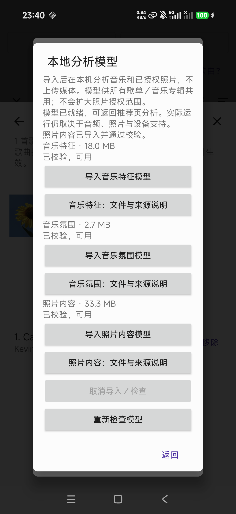
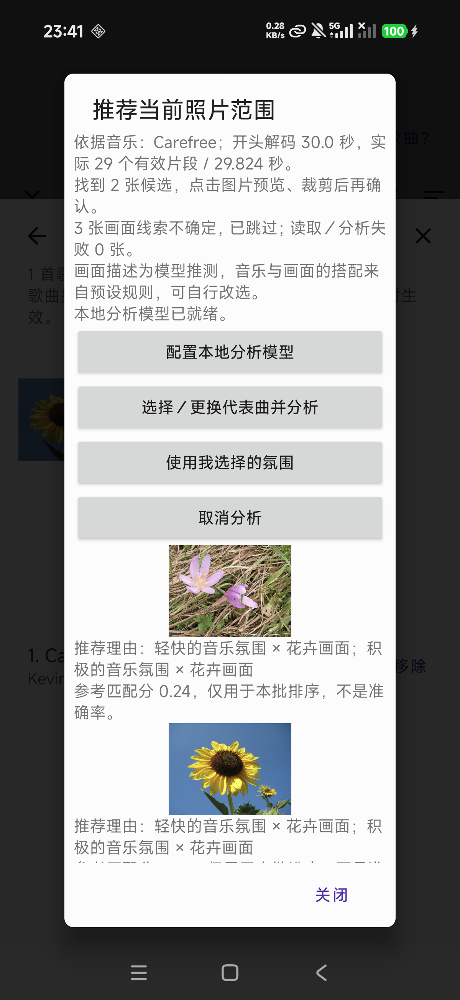
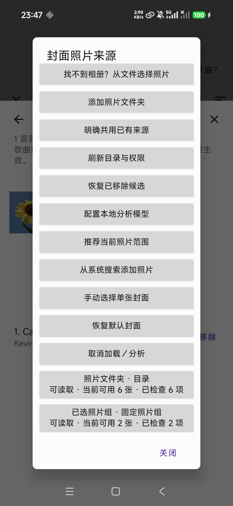
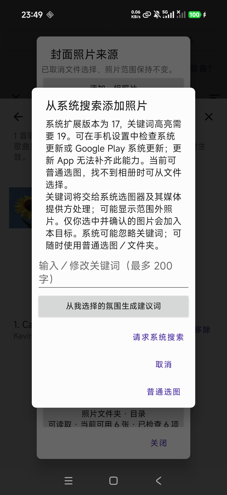

# Picker investigation and conservative scene-model experiment

The Xiaomi album selection gap was resolved in the observed session, and the two
flower fixtures no longer produce a butterfly explanation with the new model.
**The new model is not accepted as an overall ranking-quality improvement.** It
returns fewer candidates, and the four frozen provisional ranking cases regress.
PR #50 remains a draft; formal acceptance criteria remain unchecked.

## System search and Xiaomi Gallery

The same Redmi remains Android 16 / T extension 17; the public keyword-highlighting
interface requires extension 19. A real update check returned “系统已是最新版本”.
The inspected security page did not expose a Google Play module update, and the
standard module-update settings intent had no handler. Updating this app cannot
raise a system extension. The app now displays the actual version, the requirement,
and the system/Google Play update paths while retaining ordinary selection.

The six fixture images were indexed in Android MediaStore, readable as files, and
had no `.nomedia` ancestor. After opening Xiaomi Gallery, they appeared in
**影集 → 相册 → 其他相册**. The app's ordinary picker then showed the same folder in
**影集 → 相册 (horizontal scroll) → 其他相册**. One sunflower was selected, returned
to the explicit QA1108 confirmation, and became a readable one-photo source.
Removing that temporary source retained the original six-photo directory and cover.
Gallery startup and elapsed indexing time were not isolated, so the exact internal
refresh cause is unproven. No gallery database or personal album setting was changed.

The new **找不到相册？从文件选择照片** action provides a separate public SAF image
multi-select route with the same target/grant confirmation. More than 100 selected
URIs are rejected without adding a partial source. Emulator UI tests verified
launch and cancellation without changing the existing source. After the user
unlocked the phone, the new route also returned two explicitly selected fixture
images through Xiaomi's file picker. Target confirmation added a readable
two-image source; both images remained readable after force-stop/relaunch. Removing
that temporary source retained the original six-image directory. Cancelling a
subsequent file selection displayed that the photo scope remained unchanged.

## Model and explanation changes

The old MobileNet ImageNet classifier has a narrow scene vocabulary: its flower
cue is principally the daisy class. The replacement experiment uses a pinned
TinyCLIP image tower with 40 general scene prototypes; the model stays outside
Git and the APK. See [preparation, license, hash and preprocessing](../development/photo-scene-model.md).

Central-crop and whole-frame predictions must agree, with a cosine floor of `.20`
and a margin of `.02`. Overlapping classes can instead support an explicitly
broad family description, provided both views also beat every outside class by
the same margin. Flower/insect disagreement cannot become a broad flower label.
The decoder tests caught and corrected boundary-pixel bleed from an unmaterialized
crop. Unrelated image classes remain in the competition; they are not all forced
into a mood-associated scene.

The UI uses Chinese music/scene descriptions, marks them as model guesses and
editorial associations, identifies broad descriptions, reports uncertainty and
read failures separately, and explains that the ranking score is not accuracy.
Manual mood and cover choices remain available. Existing music associations are
retained where their scene classes still exist; new scenes extend the mapping.
Old photo-model imports get an update-required state; music models and saved covers
remain intact, and failed imports preserve the previous files.

Two author checkpoints were compared on the same 33 unique licensed images using
the same initial vocabulary and thresholds. TinyCLIP 8M and 40M each initially
accepted 9/33 specific labels. The 8M version accepted both flower regressions;
40M initially abstained on the pink flower. Broad families subsequently increased
accepted cues to 11/33 (8M) and 14/33 (40M) in desktop comparison, but did not establish
an overall ranking improvement. The 8M experimental artifact is 33,305,014 bytes.
This is development/model selection on a small known set, not a blind accuracy study.

Actual Android inference now reports `flowers` for both img_0001 (sunflower) and
img_0002 (pink meadow saffron), cosine scores approximately `.369` and `.385`.
The latter previously received a butterfly explanation. These are two regression
examples, not evidence that all flower/butterfly errors are solved.

## Four-case actual inference and frozen post-evaluation

All four original representative audio files and all 20 neutral image inputs per
case were processed by production MoodAnalyzer, OnnxPhotoFeatureExtractor and
PhotoRanker on the disposable API 33 emulator. No expected relevance file was
available to the Android test. The separate unchanged evaluator read the frozen
provisional labels only after inference. Candidate identifiers/hashes, actual
music scores, scene cues, rules and timings are retained in
[raw inference](evidence/photo-quality-2026-11-08/real-ranking.json) and
[evaluation](evidence/photo-quality-2026-11-08/evaluation.json).

| Case | Old returned / relevant | New returned / relevant | Old P@5 | New P@5 | Old / new hard distractors |
|---|---:|---:|---:|---:|---:|
| 01 | 5 / 5 | 3 / 3 | 1.00 | 0.60 | 0 / 0 |
| 02 | 5 / 5 | 3 / 3 | 1.00 | 0.60 | 0 / 0 |
| 03 | 4 / 2 | 4 / 1 | 0.40 | 0.20 | 2 / 2 |
| 04 | 5 / 4 | 1 / 1 | 0.80 | 0.20 | 1 / 0 |

Missing Top-5 slots count as zero: mean P@5 falls **0.80 → 0.40**. Precision among
returned candidates is **16/19 → 8/11**; case 03 still has two hard distractors.
The smaller hard-distractor total partly reflects returning fewer images and is
not a general precision improvement. The first overly strict pass had mean P@5
0.35; preserving existing associations and allowing broad descriptions improved
that to 0.40, still below the old baseline. Labels were not changed, and no
per-image or per-case exception was introduced to improve these numbers.

All 80 per-case image extractions completed without errors. Cold extraction of
20 images took 2.30–2.58 seconds per case; cached extraction took 0.21–0.28 seconds.
These are emulator timings, not measured Redmi performance. The final APK used
for this real-inference pass has SHA-256
`69c892da4fe92911f8aed3e8156c78ec1a6240c5f6ee18b64dd7cc53c720a3a7`.
The run occurred before commit; the evidence records its base and a digest of the
complete production source tree rather than pretending it was a clean-HEAD run.

## Final physical-device follow-up

After the user unlocked the phone, the clean `1b10cc42` APK was installed in place
(SHA-256 `6ae9395fcc240f0ab3338bd7c018cd2ccee1edeb91db72dd1c00273f32aa7ce6`).
The model page correctly showed the old photo model as update-required while both
music models remained ready. The new TinyCLIP artifact was selected through the
system file picker, passed length/hash validation, and all three models became
ready. The installed photo artifact hash matches the documented export. Readiness
survived force-stop/relaunch; the previous photo-model file was retained.

Real Carefree analysis used 29 effective patches / 29.824 seconds and the existing
six-photo authorized directory. The phone returned **two flower candidates**,
reported **three uncertain images** and **zero read/analysis failures**. Both the
pink flower and sunflower now have Chinese flower explanations; the UI explicitly
identifies model guesses, preset music/scene associations and non-accuracy scores.
The pink-flower crop preview opened, and cancellation retained the saved sunflower
cover. This six-photo regression confirms the intended explanation change, not
overall ranking quality. No instrumented phone latency benchmark was taken.

The two original playlist records, all ten previously seeded files and the saved
cover were checked unchanged after all operations. The QA playlist retains its
original six-photo directory and sunflower cover; temporary selected-photo groups
were removed. The test APK and imported experiment remain installed for review.
The temporary USB stay-awake setting was restored to its original `0` value.
Only licensed QA images were selected; no broad photo permission was added.

## Verification boundaries

- JVM tests cover score ordering/deduplication, no-match behavior, version messaging,
  wrong/ambiguous scene outputs, broad-family boundaries and Chinese explanations.
- Real Android tests cover image preprocessing, import recovery/migration and
  picker cancellation. The initial combined real-inference/UI run passed 8 tests;
  the final real-inference run passed again after the family/mapping refinements.
- Local UTP aborted before running any tests due to a protobuf `IllegalAccessError`.
  The documented legacy Gradle runner was used locally; CI settings and assertions
  were not weakened. An existing CI race at PhotoUiTest's immediate window check
  was replaced by waiting for the actual app window. DocumentsUI Back can traverse
  parent directories; cancellation now waits for the real return with a bounded loop.
- Clean `1b10cc42`: 104 JVM, 63 executed Android, 159 backend and 22 web tests passed;
  four optional-resource Android tests skipped, not counted as real inference.
  Cumulative line coverage over all 67 production files, including Release 1:
  Android 2584/3168 = 81.565657%, backend 882/920 = 95.869565% (local Python 3.14),
  web 812/825 = 98.424242%. No scope or gate reduction; JaCoCo class-ID audit passed.
  [Push CI](https://github.com/Axfff/Vibe-Player/actions/runs/42495110075) and
  [PR CI](https://github.com/Axfff/Vibe-Player/actions/runs/42495117310) both passed.
  This final follow-up adds documentation/screenshots only; production remains at
  that tested commit. Test execution does not constitute subjective acceptance.

The screenshot fixtures retain complete creator/license/source/change information
in [attribution](evidence/photo-quality-2026-11-08/fixture-attribution.json). The full
frozen dataset and original evaluation remain linked in the earlier
[evidence README](evidence/photo-scopes-2026-11-07/README.md). No personal photos,
device serial, raw phone UI dumps, private backups, credentials or weights are
included in this evidence.
