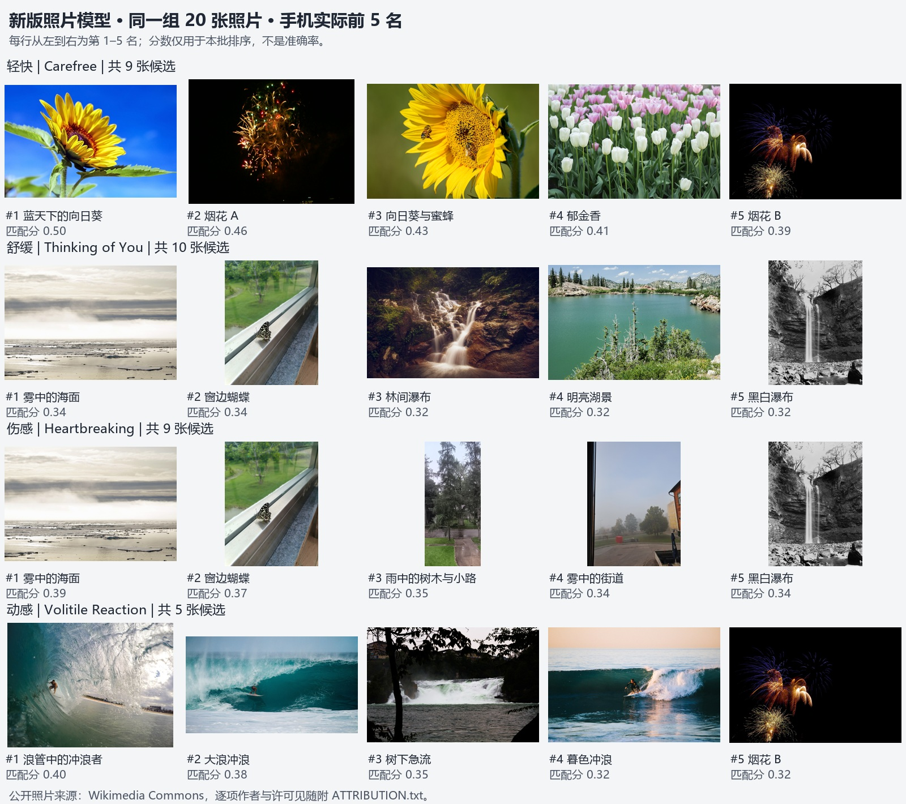

# New-photo recommendation review, 11 November 2026

V4 improves the action recommendations on the physical Redmi and keeps scene
explanations visible. It does **not** fully solve the overlap between calm and
reflective music. Production implementation: `14dd5ac8952f37ef72982ebd85ddb8c5873284ca`.
All results below use real local models; no photo filename, song title or relevance
label enters inference or ranking. Main and release1 remain unchanged.

## Change and cost

- Replace the 8M TinyCLIP image tower with the pinned 40M tower, retaining the same
  two image views, 40 scene/four atmosphere prompts, confidence gates and v3 ranking
  formula. The exported model grows from 33,313,206 to **158,993,255 bytes**; it is
  imported separately, not bundled in the APK. Music models and permissions are unchanged.
- The representative excerpt now shows its strongest usable music cues. When calm
  and reflective cues coexist, the app explains why results may overlap and points
  to the existing manual atmosphere choice. It does not infer sadness from a title.
- Keep the concrete scene line alongside the broad atmosphere explanation. Previously
  `take(2)` could hide it when two atmosphere reasons were present.
- Old v3 model imports show update required, preserving the old file and all existing
  covers/scopes. Hash-checked atomic import and cancellation behavior are retained.

The [export receipt](evidence/photo-quality-v4-2026-11-11/tinyclip-atmospheres-v4.json)
and independent [repeat export](evidence/photo-quality-v4-2026-11-11/repeat-v4.json)
have the same SHA-256 `c6811b6a8127a3091e2fc21e0a5b48f0234de40afa30472028b15ab215092dd9`.
The exporter also reproduces v3 with `--variant 8m`. Preparation and licensing are
documented in [the model guide](../development/photo-scene-model.md).

## Same 20 photos, before and after on the phone

The user requested a previously untested public-photo pool. Its
[manifest](evidence/photo-quality-v4-2026-11-11/fresh-manifest.json) and
[qualitative plan](evidence/photo-quality-v4-2026-11-11/fresh-pre-inference-plan.json)
were frozen **before v3 inference**. After reviewing those results, this pool became
a development comparison for v4, not an unseen test set. Each song used the same
explicitly authorized folder, actual first-30-second audio analysis and actual
on-phone photo inference. No new cover was saved.

| Excerpt | V3 phone result | V4 phone result |
| --- | --- | --- |
| Carefree | Three flower images and two fireworks | Same five subjects, reordered; flowers are not called butterflies |
| Thinking of You | Lake, indoor butterfly, foggy sea, foggy street, window butterfly | Foggy sea, window butterfly, forest waterfall, lake, monochrome waterfall |
| Heartbreaking | Foggy sea, indoor butterfly, foggy street, bright lake, rushing water | Foggy sea, window butterfly, rainy trees/path, foggy street, monochrome waterfall |
| Volitile Reaction (embedded title) | Three surfers, monochrome waterfall, rainy London street | Three surfers, rushing water and fireworks; rainy street leaves the top five |

Calm/reflective top-five overlap drops from **4/5 to 3/5** on this phone. The bright
lake leaves the reflective top five, but the window butterfly still ranks second.
This is a bounded qualitative improvement, not a claim of solved mood recognition.
The two excerpts both produce relaxing and sad audio cues, now visible to the user.
Fireworks can still receive the coarse `party` scene label; scene descriptions remain
model guesses requiring preview confirmation.

[V3 phone baseline](evidence/photo-quality-v4-2026-11-11/phone-v3-baseline.json) ·
[V4 phone results and preservation checks](evidence/photo-quality-v4-2026-11-11/phone-results.json) ·
[Photo authors and licenses](evidence/photo-quality-v4-2026-11-11/fresh-ATTRIBUTION.txt).
The comparison sheet arranges resized source thumbnails; source downloads are unchanged.

The new APK was installed in place and the new model imported through Xiaomi's
normal file picker. All four runs had zero unreadable/failed photos. Original
playlists, saved cover bytes, all scope bindings, both music models, the old v3
model and all **33** previously seeded media files were verified unchanged.
Temporary screen-awake and notification-banner settings were restored. No personal
photos, private preferences, device identifiers or unrelated notifications are published.

## Frozen development cases and separate additional pool

On the original four frozen fixture cases, actual API 33 inference retains provisional
P@5 **1.00 / 1.00 / .80 / 1.00**, mean **.95**, with zero failures over 80 photo inputs.
V3 had the same mean; old MobileNet had `.80`, scene-only v2 `.40`. The bright-lake
distractor still affects the original reflective case. These labels were already
seen and are provisional: **not human ground truth or a generalization accuracy**.
[Full evaluation](evidence/photo-quality-v4-2026-11-11/development-evaluation.json).

A separate [12-image pool](evidence/photo-quality-v4-2026-11-11/holdout-manifest.json)
was frozen after selecting the 40M model and before inference. It uses the first
eligible result for each fixed Commons search query, neutral identifiers and the
same pool for all four songs. No prompts, thresholds or ranking rules were adjusted
after viewing its results. Search results include three paintings and a cup-shaped
building rather than only ordinary camera photos; this mixed input is retained and
disclosed, not silently replaced. It is an exploratory robustness check with no
formal relevance labels.

The actual Android intense case returns only the two water-action images above the
existing threshold, rather than padding to five. Flowers/fireworks lead the light
case; calm/reflective still overlap. Across its 48 photo inputs there are zero
failures and one uncertain image per song. Paintings can be described by depicted
scenes instead of reliably recognized as artwork. Broad semantic limits remain.
[Raw results](evidence/photo-quality-v4-2026-11-11/photo-holdout-android.json) ·
[Authors/licenses](evidence/photo-quality-v4-2026-11-11/holdout-ATTRIBUTION.txt).

Desktop previews and API 33 ordering differ slightly from the physical API 37 phone
because decoding and actual audio/image execution differ. The phone table above is
transcribed from its own UI, not substituted from desktop predictions.

## Validation and review boundary

- 113 JVM tests pass, including mixed-music summaries, invalid signals and preserving
  a scene explanation with multiple atmosphere cues.
- Seven model-setup/UI tests and the image-preprocessing test pass on API 33; model
  setup covers v3 migration and atomic/cancelled/invalid imports. The first local
  command included one nonexistent test-class name; its initialization failure is
  excluded and the intended preprocessing class was then run successfully.
- Actual Android inference covers four old cases, four fresh-pool cases and four
  additional-pool cases, with reversed candidate input order checked in each.
- The API 21/23 fixture writer initially hit MediaStore write permission restrictions.
  Its legacy path now uses a read-only public-fixture provider in the test APK; the production app
  receives no additional storage permission. Native-model compatibility evidence is
  recorded separately from the previous full picker/crop/reboot acceptance.
  With that fixture transport corrected, **API 21 and API 23 each pass all four
  real audio/photo cases**, 80 photo inputs and zero failures per emulator, retaining
  the same provisional `.95` mean. See [API 21](evidence/photo-quality-v4-2026-11-11/api21-inference.json)
  and [API 23](evidence/photo-quality-v4-2026-11-11/api23-inference.json).
- The cumulative coverage scope still includes all 67 changed production files.
  Current-head CI and coverage are recorded in PR #50 after the run completes.

Formal #40/#41 acceptance and human relevance review remain open. The unresolved
ONNX 16 KB native-alignment warning is tracked in #55 and is not fixed by this
model change. No merge, release-tag movement or main-branch push was performed.
